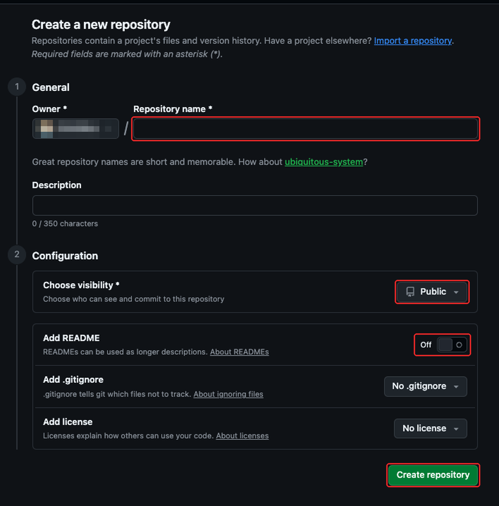
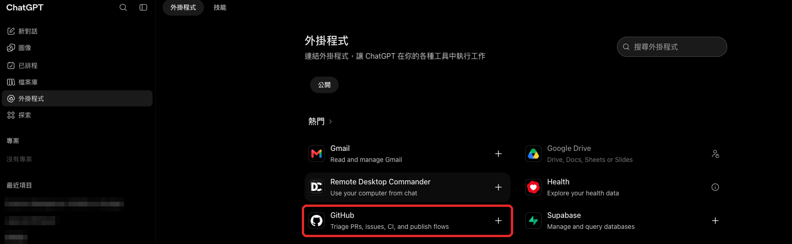
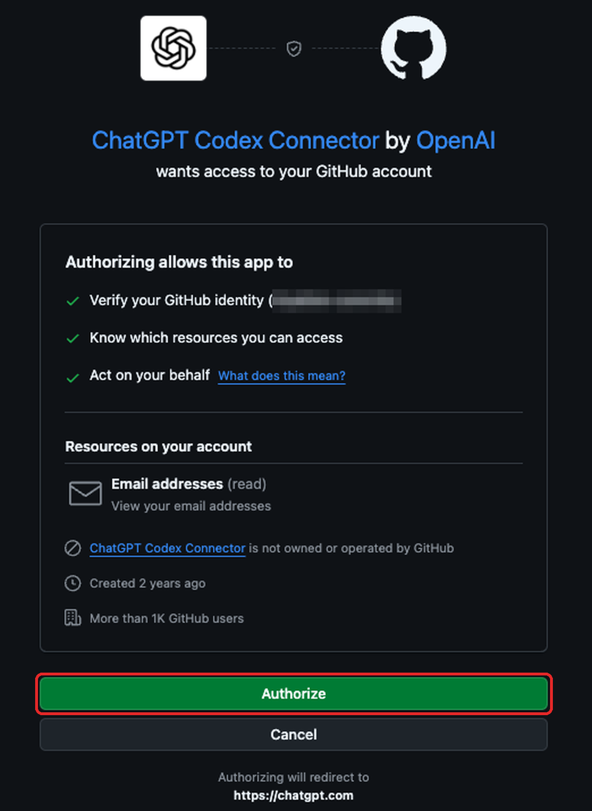
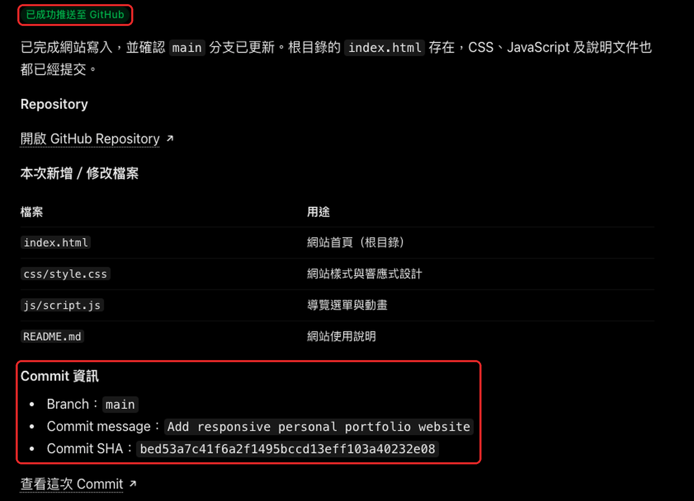
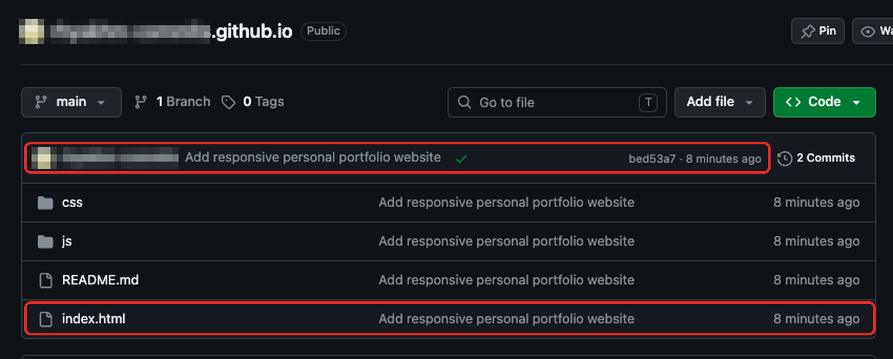

+++
date = '2026-11-23'
draft = true
title = 'AI 省時小工具（3） - 用 ChatGPT 串接 GitHub，做一個自己的個人網站'
description = '讓 ChatGPT 連上 GitHub，請它做好個人網站並直接寫進 Repository，再用 GitHub Pages 免費發布，拿到一個可以分享的網址。'
tags = ['ChatGPT', 'GitHub', 'GitHub Pages', '個人網站']
topics = ['AI 省時小工具']
+++

## 前言

這篇要用 ChatGPT 做一個自己的個人網站，從版面、文字到程式都交給它寫，寫好之後由 ChatGPT 直接存進 GitHub，再用 GitHub Pages 免費發布到網路上。整個過程不需要會寫程式，也不需要買主機或網域，順利的話大約半小時可以完成。

整個流程是這樣：

1. 在 GitHub 建立一個放網站的地方
2. 把 ChatGPT 連上 GitHub
3. 請 ChatGPT 做出個人網站
4. 請 ChatGPT 把網站寫進 GitHub
5. 開啟 GitHub Pages，拿到網站網址

【作者補：自己為什麼想做這個網站、做完放在哪裡用】

---

## 動手前

請先準備好：

- 一個 GitHub 帳號。還沒有的話，可以先照[這篇]()註冊，並把兩步驟驗證開起來
- 一個 ChatGPT 帳號
- 一台電腦，建議使用電腦操作較為順暢

這篇會用到三個工具：

| 工具 | 用途 |
| --- | --- |
| ChatGPT | 設計和製作網站 |
| GitHub | 存放網站的檔案 |
| GitHub Pages | 免費把網站發布到網路上 |

先講幾個之後會看到的名詞，看過有印象就好：

- **Repository**：GitHub 上的一個專案資料夾，網站的所有檔案都放在裡面
- **Commit**：一次修改的紀錄，每改一次網站就會多一筆
- **Branch**：分支，這篇只會用到預設的 `main`

---

## 步驟一：在 GitHub 建立網站用的 Repository

1. 登入 GitHub，點右上角的 **+**，選 **New repository**
2. **Repository name** 填網站的名稱，例如 `my-website`，只能用英文字母、數字和連字號
3. 可見度選 **Public**。免費帳號的 GitHub Pages 只能用在公開的 Repository
4. 把 **Add README** 打開
5. 按 **Create repository**


<!-- 截圖：GitHub「Create a new repository」頁面，標出 Repository name、Public、Add README 與 Create repository 按鈕 -->

Repository 的名字會出現在網址裡。如果把名字取成 `你的帳號.github.io`，網址就會是比較短的 `https://你的帳號.github.io/`，其他名字的網址則是 `https://你的帳號.github.io/Repository名稱/`。


公開的 Repository 任何人都看得到裡面的檔案，不要把電話、住址、身分證字號這類個資寫進網站。


---

## 步驟二：讓 ChatGPT 連接 GitHub

1. 打開 ChatGPT，點帳號名稱，進入 **設定**
2. 選 **Plugins**，找到 **GitHub**，按連接
3. 畫面會跳到 GitHub，依畫面指示安裝並授權 ChatGPT
4. 選擇 ChatGPT 可以使用哪些 Repository。建議選 **Only select repositories**，只勾剛剛建立的那一個


<!-- 截圖：ChatGPT 設定 > Plugins 頁面，標出 GitHub 與連接按鈕 -->


<!-- 截圖：GitHub 授權 ChatGPT 的頁面，標出 Only select repositories 與勾選的 Repository（帳號名稱與大頭貼請打馬賽克） -->

連接成功之後，ChatGPT 就能讀取並修改你授權的 Repository。之後想調整範圍，回到 **設定** > **Plugins** > **GitHub** 修改即可；不想用了，在同一個地方按 **Disconnect**。

剛建立的 Repository 可能要等幾分鐘才會出現在 ChatGPT 裡。

---

## 步驟三：請 ChatGPT 做出個人網站

開一個新的對話，把下面的提示詞複製貼上，【】裡換成自己的資料：

```text
請幫我建立一個個人介紹網站。

我的資料：
- 姓名：【王小明】
- 職業：【平面設計師】
- 自我介紹：【喜歡設計與創作，擅長將想法轉化成視覺作品。】
- 作品：【平面設計、品牌識別、網站設計】
- 聯絡方式：【example@gmail.com】

網站需求：
1. 使用 HTML、CSS、JavaScript。
2. 採用響應式設計，手機也能正常瀏覽。
3. 設計簡潔、現代。
4. 包含個人介紹、作品展示、聯絡資訊。
5. 不使用需要付費的外部服務。
6. 網站入口使用 index.html。

請先規劃網站架構，再建立完整的網站檔案。
```

ChatGPT 會先列出網站的架構，再產生網站檔案。不需要一次就做到滿意，可以繼續在同一個對話裡請它調整，例如：

| 想調整的地方 | 複製這句貼給 ChatGPT |
| --- | --- |
| 顏色 | 請把網站的主色改成【墨綠色】，其他顏色跟著搭配。 |
| 字體 | 請把標題改成比較粗的字體，內文維持好閱讀的字體。 |
| 版面 | 請把作品展示改成一排三個的卡片，手機上改成一排一個。 |
| 作品圖片 | 我上傳了幾張作品圖，請放進作品展示區，並幫每張加上簡短說明。 |
| 自我介紹 | 請把自我介紹改寫得更口語一點，控制在三句話以內。 |


<!-- 截圖：ChatGPT 對話中產生的網站預覽或檔案清單（畫面上的 Email 等個資請打馬賽克） -->

---

## 步驟四：請 ChatGPT 把網站寫進 GitHub

網站調整好之後，在同一個對話裡貼上：

```text
請幫我將剛剛完成的個人網站寫入我的 GitHub。

Repository：【你的帳號/my-website】
Branch：main

請依照以下步驟執行：
1. 確認 Repository 是否存在。
2. 檢查目前的檔案結構。
3. 建立或更新網站所需檔案。
4. 確認 index.html 位於最上層。
5. 建立一筆 Commit。
6. 更新 main 分支。

請不要刪除與本次網站無關的既有檔案。
完成後，請列出修改的檔案與 Commit 資訊。
```

ChatGPT 完成後，會列出新增或修改了哪些檔案。回到 GitHub 打開這個 Repository，就能看到 `index.html` 等檔案，以及剛剛那筆 Commit。


<!-- 截圖：ChatGPT 回報修改的檔案清單與 Commit 資訊 -->


<!-- 截圖：GitHub Repository 首頁，標出 index.html 與最新一筆 Commit 訊息 -->

如果出現以下狀況，可以這樣處理：

| 狀況 | 複製這句貼給 ChatGPT |
| --- | --- |
| ChatGPT 說找不到 Repository | 請列出你目前可以存取的 GitHub Repository。 |
| ChatGPT 說沒有寫入權限 | 請說明目前缺少哪些權限，以及我要在 GitHub 哪裡調整授權。 |
| ChatGPT 只給了檔案內容，沒有寫進 GitHub | 請直接把這些檔案寫入【你的帳號/my-website】的 main 分支，並建立一筆 Commit。 |

找不到 Repository 時，也可以回到步驟二，確認授權時有勾選這個 Repository。

---

## 步驟五：開啟 GitHub Pages

網站檔案進到 GitHub 之後，就可以發布了。

1. 打開這個 Repository，點上方的 **Settings**
2. 在左側選單的「Code, planning, and automation」區塊，點 **Pages**
3. 在「Build and deployment」底下設定：
   - **Source**：選 **Deploy from a branch**
   - **Branch**：選 `main`，資料夾選 `/ (root)`
4. 按 **Save**


<!-- 截圖：Repository 的 Settings > Pages 頁面，標出 Source、Branch（main、/ (root)）與 Save 按鈕 -->

按下 **Save** 之後，GitHub 會開始發布網站，通常幾分鐘內會完成，最久可能要等到 10 分鐘。

---

## 完成之後

發布完成後，回到 **Settings** > **Pages**，頁面上方會顯示網站網址，點 **Visit site** 就能打開。網址的格式是：

```text
https://你的帳號.github.io/my-website/
```


<!-- 截圖：Settings > Pages 上方顯示「Your site is live at …」與 Visit site 按鈕（帳號名稱可視需要打馬賽克） -->

這個網址任何人都打得開，可以放在名片、社群自介或履歷上。

之後想修改網站，不需要從頭做，回到 ChatGPT 說明想改的地方即可：

```text
請幫我修改 GitHub 上的個人網站，Repository 是【你的帳號/my-website】。

我想要：
1. 【將背景改成墨綠色】
2. 【增加一個新的作品展示區】
3. 【手機版的選單改成漢堡選單】

請先讀取目前 Repository 的程式碼，說明打算怎麼修改，等我確認後再執行。
完成後請建立 Commit 並更新 main 分支。
```

ChatGPT 更新 `main` 分支之後，GitHub Pages 會自動重新發布，過幾分鐘重新整理網頁就能看到新的內容。

【作者補：自己做完的網站長什麼樣子、用了哪些調整】

---

## 常見問題

**GitHub Pages 要付費嗎？**

不用。免費帳號可以在公開的 Repository 使用 GitHub Pages；想用私人 Repository 發布，才需要付費方案。

**可以做購物網站或會員系統嗎？**

不行。GitHub Pages 只能放靜態網站，也就是 HTML、CSS、JavaScript 這類檔案，不能執行 PHP 等後端程式，也沒有資料庫。需要會員登入、儲存資料或金流時，要另外搭配後端服務。

**一定要學 Git 指令嗎？**

不用。這篇的流程全部透過 ChatGPT 和 GitHub 網頁完成。有興趣的話，可以先從前面提到的 Repository、Commit、Branch 這幾個名詞開始認識。

---

### 參考資料

- [Connecting GitHub to ChatGPT](https://help.openai.com/en/articles/11145903-connecting-github-to-chatgpt)
- [Quickstart for GitHub Pages](https://docs.github.com/en/pages/quickstart)
- [Creating a GitHub Pages site](https://docs.github.com/en/pages/getting-started-with-github-pages/creating-a-github-pages-site)

---

*本文由 AI 輔助潤稿*
