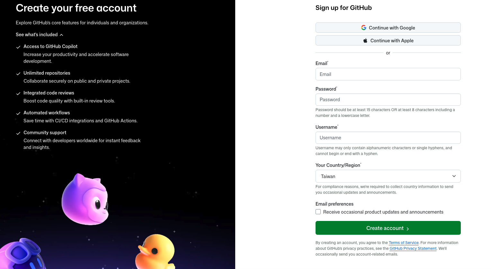
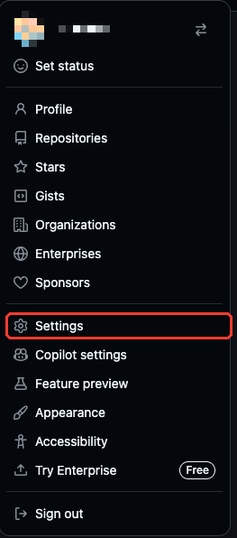
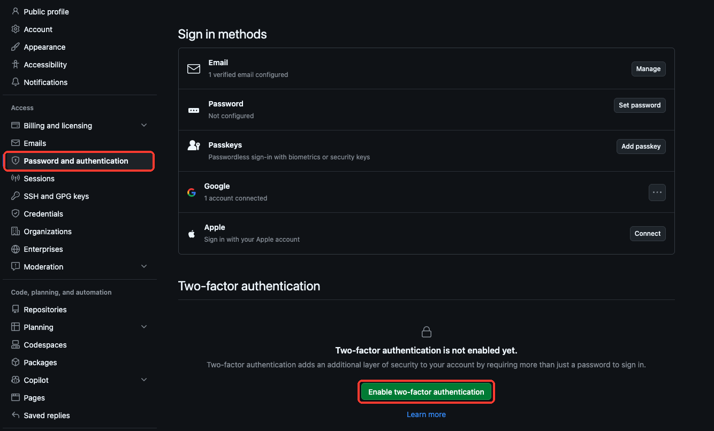
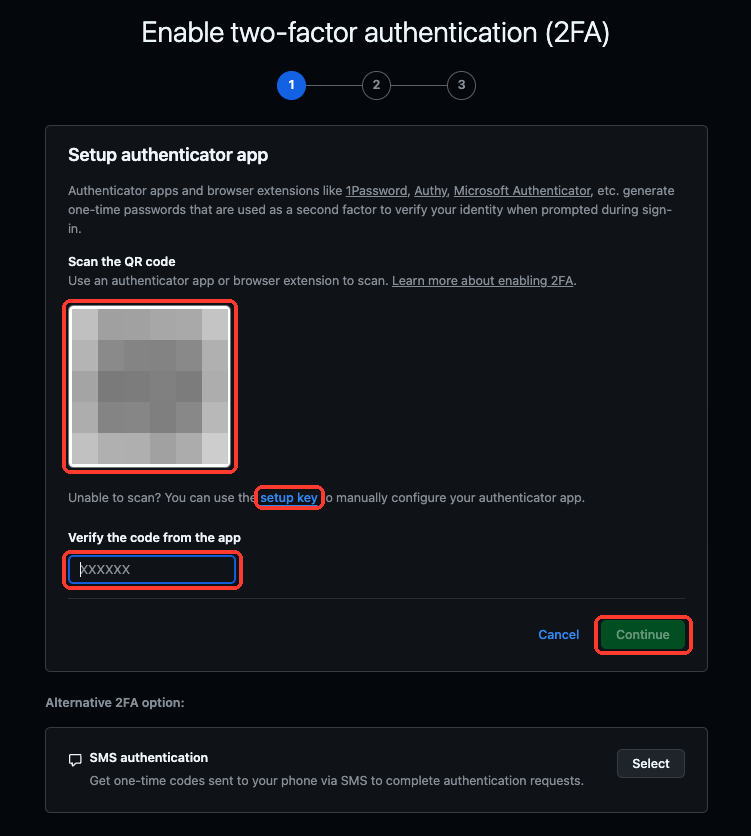
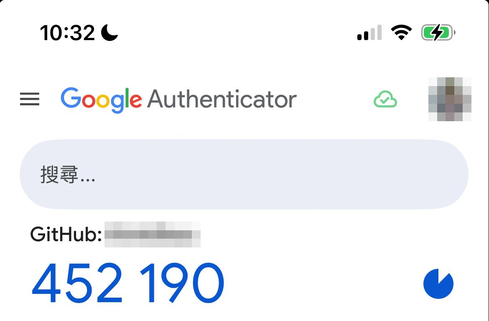
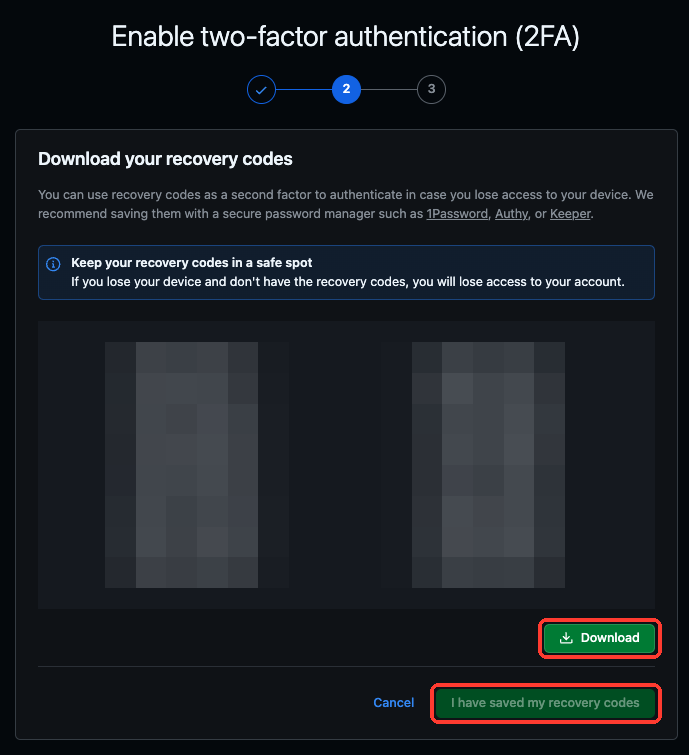
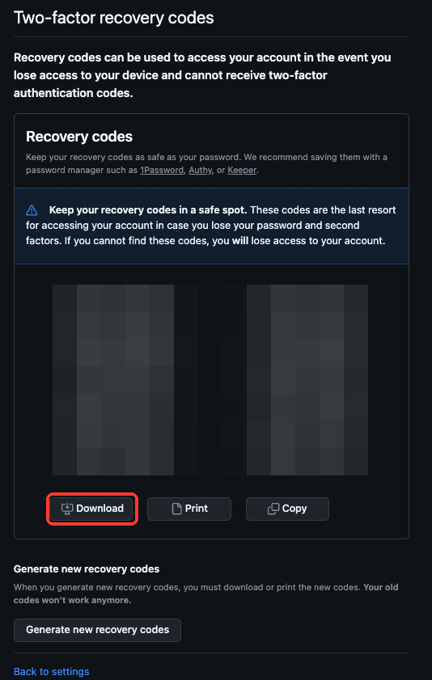
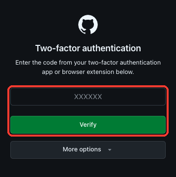

+++
date = '2026-11-18'
draft = true
title = 'AI 省時小工具（2） - 註冊 GitHub 帳號，順便把兩步驟驗證開起來'
description = '從註冊 GitHub 帳號開始，一步一步開啟兩步驟驗證（2FA），並把救援碼存好，避免手機遺失時帳號回不來。'
tags = ['GitHub', '兩步驟驗證', '帳號安全']
topics = ['AI 省時小工具']
+++

## 前言

GitHub 是一個存放程式碼和網頁檔案的網站，可以把它想成專門給程式用的雲端硬碟。想用 ChatGPT 做網站，或是把 AI 做出來的小工具放上網路，常常會用到它。這篇會從註冊帳號開始，接著把兩步驟驗證（Two-factor authentication，簡稱 2FA）開起來，最後把救援碼存好，避免帳號被盜或手機遺失時登不進去。

---

## 動手前

請先準備好：

- 一個常用的 Email 信箱，註冊時要收驗證碼
- 一支手機，用來安裝驗證器 App
- 一台電腦，用來操作 GitHub 網站。開啟兩步驟驗證時，要用手機掃描電腦螢幕上的 QR code

GitHub 的介面是英文，下面會把每個要按的按鈕原文標出來，照著找就可以。

---

## 步驟一：註冊 GitHub 帳號

1. 打開 [GitHub 註冊頁面](https://github.com/signup)
2. 依序填入以下欄位：
   - **Email**：常用的信箱
   - **Password**：密碼至少 15 個字元，或至少 8 個字元並包含數字和小寫英文字母
   - **Username**：使用者名稱，只能用英文字母、數字和單一連字號（`-`），開頭和結尾不能是連字號
   - **Your Country/Region**：選擇所在的國家或地區，例如 Taiwan
3. **Email preferences** 是詢問要不要收 GitHub 的產品消息，可以不勾
4. 按 **Create account**
5. 完成畫面上的真人驗證
6. 到信箱收 GitHub 寄來的驗證碼，輸入到註冊頁面，完成 Email 驗證

使用者名稱之後會出現在個人頁面的網址裡（例如 `github.com/你的名字`），建議取一個自己看得順眼、以後不會想改的名字。

如果習慣用 Google 或 Apple 帳號登入，也可以直接按頁面上方的 **Continue with Google** 或 **Continue with Apple** 註冊。這樣註冊的帳號不需要另外設定 GitHub 密碼，之後用 Google 或 Apple 帳號登入即可，下面開啟兩步驟驗證的步驟都一樣。

如果註冊時出現「This email can't be used」或「We couldn't create your account」，可以換一個瀏覽器、清除 Cookie，或過一段時間再試一次。

---

## 步驟二：安裝驗證器 App

兩步驟驗證的意思是：登入時除了密碼（或 Google、Apple 帳號），還要再輸入一組手機上的六位數驗證碼。就算密碼外流，別人沒有你的手機，也登入不了。

GitHub 也支援用簡訊收驗證碼，但官方比較建議使用驗證器 App，而且簡訊不是每個國家都支援。這篇以驗證器 App 為例。

在手機的 App Store 或 Google Play 搜尋並安裝其中一個：

- Google Authenticator
- Microsoft Authenticator

兩個都是免費的，選一個即可，下載時請認明開發者是 Google 或 Microsoft。安裝後建議開啟 App 裡的雲端備份功能，換手機時比較容易把驗證碼搬過去。

截圖裡的按鈕是「打開」，因為我已經安裝過了，第一次下載時會顯示「取得」。

---

## 步驟三：在 GitHub 開啟兩步驟驗證

1. 登入 GitHub，點右上角的大頭貼，選 **Settings**
2. 在左側選單的「Access」區塊，點 **Password and authentication**
3. 在「Two-factor authentication」區塊，點 **Enable two-factor authentication**

4. 畫面會出現一個 QR code。打開手機上的驗證器 App，新增帳號並選擇掃描 QR code，對準電腦螢幕即可
5. 掃描成功後，App 裡會多一筆 GitHub，並顯示一組六位數驗證碼，這組數字每 30 秒會換一次
6. 把 App 上的六位數字，輸入到 GitHub 頁面「Verify the code from the app」底下的欄位，再按 **Continue**

如果手機掃不到 QR code，或是手邊只有一支手機、沒辦法掃自己的螢幕，可以點 QR code 下方的 **setup key**，把出現的一串英數字手動輸入到驗證器 App 裡。


QR code 和 setup key 就像產生驗證碼的鑰匙，不要截圖分享給別人。


---

## 步驟四：把救援碼存好

按下 **Continue** 之後，GitHub 會給你一組救援碼（Recovery codes），總共 16 組。手機遺失、App 被刪掉的時候，可以用救援碼登入，每一組只能用一次。

1. 在「Download your recovery codes」頁面，點 **Download**，把檔案存下來。檔名是 `github-recovery-codes.txt`，通常會在電腦的「下載」資料夾裡
2. 確認存好之後，點 **I have saved my recovery codes**，兩步驟驗證就開啟完成了

存放救援碼的建議：

- 存在密碼管理工具裡，或印出來放在家裡安全的地方
- 不要只存在同一支手機裡，手機遺失時會一起不見
- 不要傳給任何人


如果手機遺失又找不到救援碼，GitHub 客服基於安全考量，可能無法幫你恢復帳號。


如果當時沒存到，之後也可以補：到 **Settings** → **Password and authentication**，在「Recovery codes」旁邊點 **View**，就會看到下面這個頁面。按 **Download** 下載，也可以按 **Print** 印出來，或按 **Copy** 複製到密碼管理工具。

---

## 開啟之後

之後在新的電腦登入、登出後再登入，或做比較敏感的操作時，輸入密碼或用 Google、Apple 帳號登入之後，GitHub 會再請你輸入驗證器 App 上的六位數驗證碼。打開 App 就能看到最新的數字，輸入後按 **Verify**。

如果手機不在身邊，或驗證器 App 被刪掉了，可以在同一個畫面點 **More options**，選 **2FA recovery code**，輸入其中一組救援碼，再按 **Verify**。用過的那一組就不能再用了。

開啟後的 28 天內，GitHub 會確認你能不能正常使用兩步驟驗證。這段期間只要正常登入、輸入過一次驗證碼就可以了。


GitHub 不會打電話或傳訊息跟你要驗證碼或救援碼。有人跟你要，就是詐騙。


到這裡，GitHub 帳號已經註冊好，兩步驟驗證已經開啟，救援碼也存好了。有了這個帳號，接下來就可以開始動手做各種專案，例如用 ChatGPT 串接 GitHub，做出一個自己的網站。

---

### 參考資料

- [Creating an account on GitHub](https://docs.github.com/en/get-started/start-your-journey/creating-an-account-on-github)
- [Configuring two-factor authentication](https://docs.github.com/en/authentication/securing-your-account-with-two-factor-authentication-2fa/configuring-two-factor-authentication)
- [Configuring two-factor authentication recovery methods](https://docs.github.com/en/authentication/securing-your-account-with-two-factor-authentication-2fa/configuring-two-factor-authentication-recovery-methods)
- [Accessing GitHub using two-factor authentication](https://docs.github.com/en/authentication/securing-your-account-with-two-factor-authentication-2fa/accessing-github-using-two-factor-authentication)

---

*本文由 AI 輔助潤稿*
