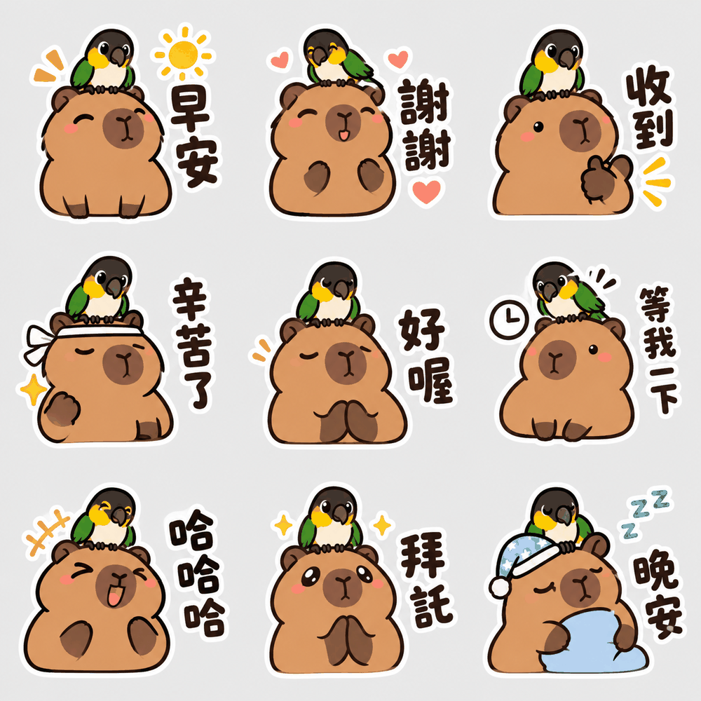
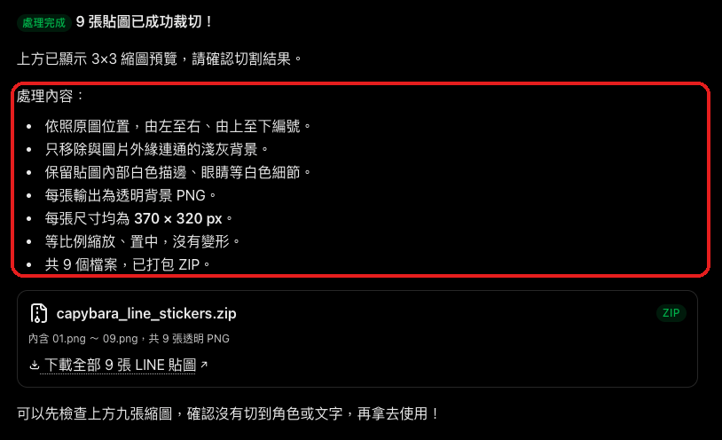
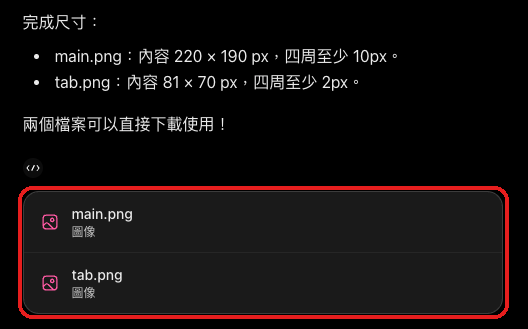
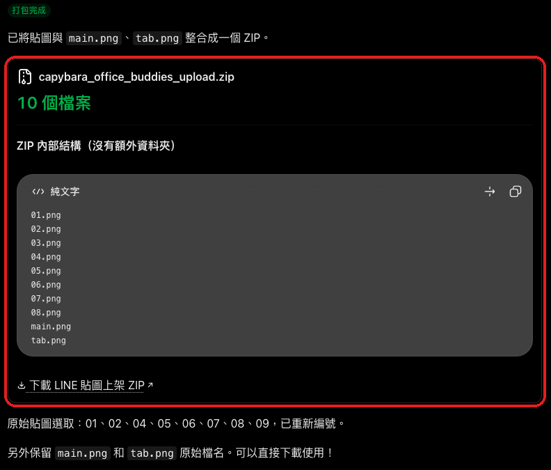
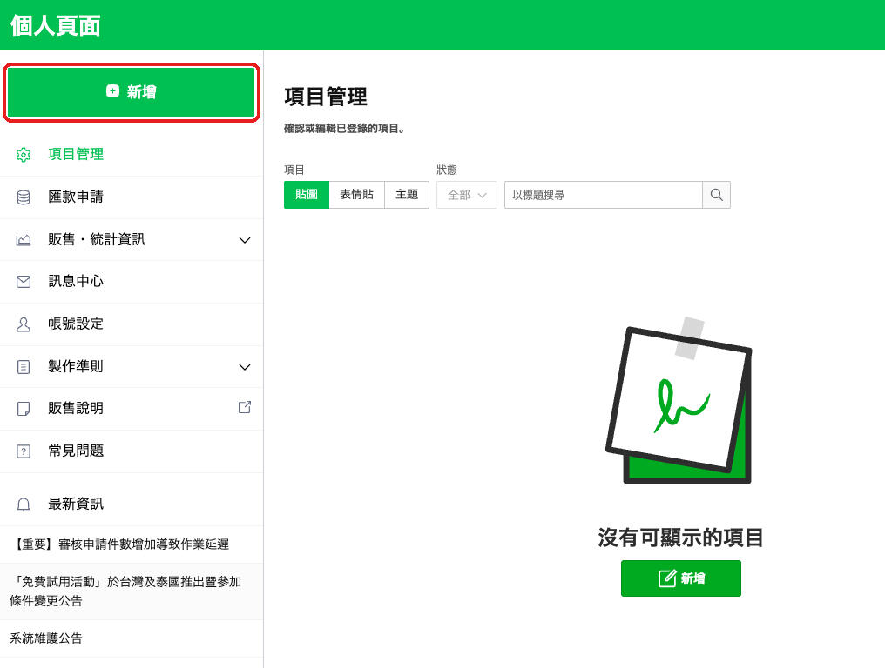
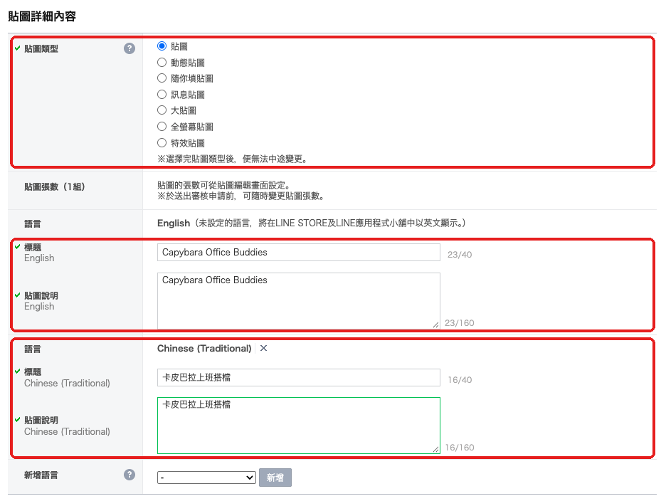
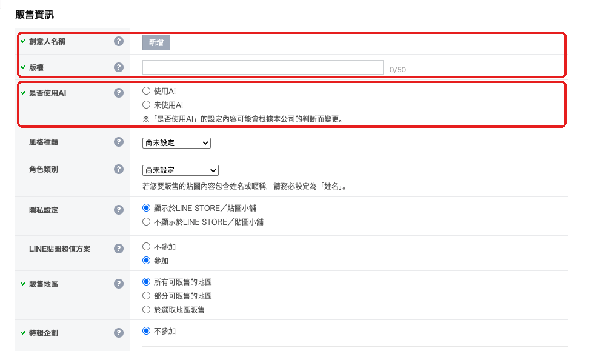
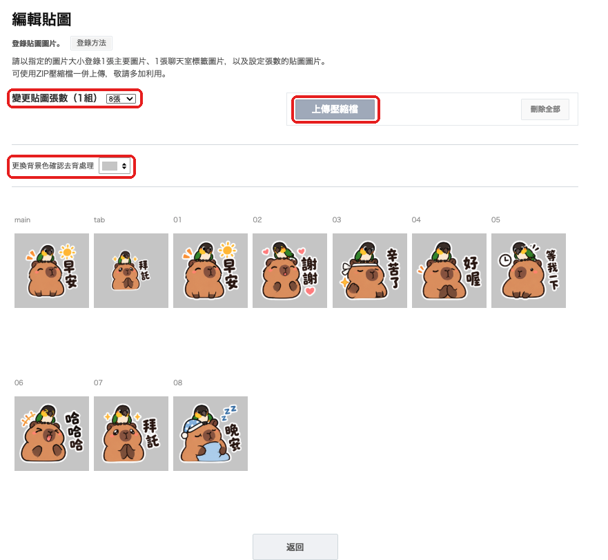
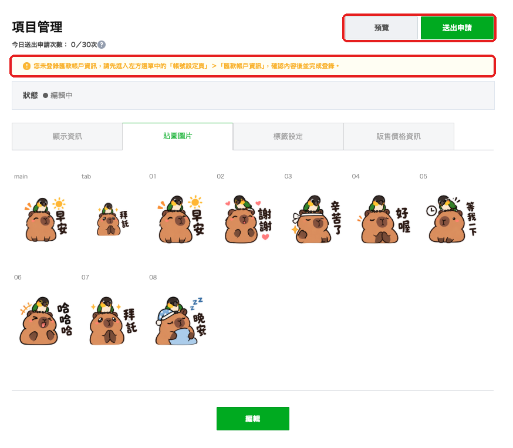
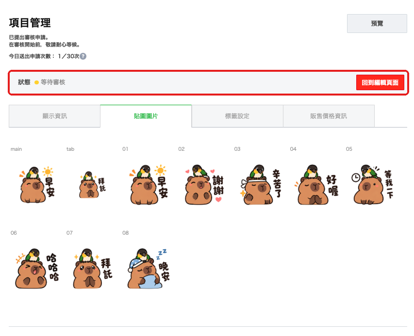

+++
date = '2026-11-16'
draft = false
title = 'AI 省時小工具（1） - ChatGPT 畫好的貼圖，怎麼切好、上架到 LINE？'
description = 'ChatGPT 畫完九宮格貼圖之後，切圖、去背、做封面、寫上架文字，其實也能丟回給 ChatGPT。附上我用過的提示詞。'
tags = ['LINE 貼圖', 'ChatGPT', 'AI 工具']
topics = ['AI 省時小工具']
+++

## 前言

都說有 AI 能夠自己畫圖，不如就來自己做 LINE 貼圖吧！現在 ChatGPT 不僅能畫圖，切圖、去背、做封面也能一手包辦，我只負責複製貼上、按下載。下面是我整理出來的流程跟提示詞，替換成自己需要的元素，讓我們一步一步操作。


<!-- 截圖：作者上架成功的貼圖，例如 LINE 貼圖小舖的貼圖頁面，或在聊天室裡使用的畫面（聊天對象的名字、頭像請打馬賽克） -->

---

## 動手前

我用的是免費版 ChatGPT。免費版的畫圖、上傳檔案都有使用額度限制，額度用完時，可以隔一段時間再繼續，分幾次完成。上架要用 LINE 帳號登入 [LINE Creators Market](https://creator.line.me/zh-hant/)。畫圖、切圖用手機就能完成；上架要用電腦的瀏覽器操作，手機版網頁目前找不到新增貼圖的地方。

LINE 對貼圖有明確的規格要求，我整理成一張表，後面的提示詞都已經照這張表寫好了：

| 要準備的圖 | 尺寸 | 檔名 |
|---|---|---|
| 貼圖 | 最大 370×320 | `01.png`、`02.png`…… |
| 主要圖片（封面） | 240×240 | `main.png` |
| 聊天室標籤（小圖示） | 96×74 | `tab.png` |

除了尺寸，所有圖片還有幾項共同要求：必須是 PNG 格式、背景透明、每張檔案在 1MB 以內，寬和高都要是偶數。另外，一套貼圖的張數只能選 8、16、24、32 或 40 張其中一種。

---

## 步驟一：畫出好切的九宮格

如果你已經有九宮格大圖，可以跳過這一步。

開一個新對話，貼上以下提示詞：

```text
請幫我畫一張 LINE 貼圖用的圖，規則如下：

角色：【一隻卡皮巴拉，頭上常常站著一隻黑頭凱克鸚鵡】
畫風：【可愛 Q 版、粗線條】

1. 一張圖裡排 3 欄 × 3 列，總共 9 張貼圖
2. 每張貼圖之間留明顯的空隙，不要畫格線、外框
3. 背景用純淺灰色（#E6E6E6）單色，不要漸層、不要花紋、不要陰影
4. 每張角色外圍加一圈白色描邊
5. 每張配一句短短的中文字，字要照我寫的，不要改字、不要加字：
   【早安、謝謝、收到、辛苦了、好喔、等我一下、哈哈哈、拜託、晚安】
6. 9 張的角色長相、顏色、畫風都要一致
```

第二組請在同一個對話裡接著貼，角色比較不會跑掉：

```text
請完全照剛剛的角色長相、顏色、畫風和排版規則，再畫一組 9 張，這次的字是：
【我到了、出發、加油、沒問題、生日快樂、抱抱、對不起、讚、休息一下】
```




以上架 32 張為例，可以畫 4 組共 36 張，再從中挑選 32 張。

如果畫出來的結果不理想，可以用以下提示詞修正：

| 狀況 | 複製這句貼給 ChatGPT |
|---|---|
| 角色越畫越不像 | `請回到第一組的角色長相重畫，臉型、眼睛、顏色都要跟第一組一樣。` |
| 貼圖黏在一起 | `請重畫，每張貼圖之間的空隙要再加大，貼圖之間不能互相碰到。` |
| 字寫錯了 | `第【5】張的字寫錯了，正確是【好喔】，請只修改這張的字，其他不要動。` |
| 背景不是單色 | `請重畫，背景只能是純淺灰色（#E6E6E6），不能有漸層、陰影或花紋。` |

---

## 步驟二：請 ChatGPT 幫你切圖

把九宮格大圖下載下來，開一個新對話上傳，貼上。之後的切圖、做封面、打包都在這個對話裡完成，中間不用另外下載：

```text
這張圖是 3 欄 × 3 列、共 9 張的 LINE 貼圖，背景是淺灰色。
請用 Python 處理這張圖片檔（不要重新畫圖）：

1. 依背景顏色找出 9 張貼圖的位置，由左到右、由上到下排好
2. 每張分別裁切，只把「從圖片邊緣連過來」的背景色變成透明，
   貼圖內部的白色（描邊、眼睛）要保留
3. 每張等比例縮放、置中放到 370×320 的透明畫布上，四周至少留 10px，不要變形
4. 存成 PNG，檔名從【01】開始依序編號（01.png、02.png……）
5. 給我看 9 張縮圖，讓我確認有沒有切壞
```

第二組大圖上傳到同一個對話，把提示詞裡的【01】改成【10】；第三組改成【19】，以此類推，檔名就不會重複。

如果 ChatGPT 重新畫了一張圖，而不是處理檔案，請補上這句：「不要畫圖，用 Python 處理我上傳的檔案。」



如果裁切結果不理想，可以用以下提示詞修正：

| 狀況 | 複製這句貼給 ChatGPT |
|---|---|
| 邊緣還有灰灰的背景 | `去背不乾淨，請把背景顏色的容許範圍放寬一點，重新處理。` |
| 角色身上白色的地方不見了 | `角色內部的白色被去掉了，請把容許範圍調小，只去掉從邊緣連過來的背景。` |
| 兩張被切在一起 | `【04.png】裡面有兩張貼圖，請改成平均切成 3 欄 3 列重新裁切。` |

---

## 步驟三：做封面和小圖示

除了貼圖，LINE 還需要一張封面（main）和聊天室下方的小圖示（tab）。tab 尺寸很小，建議選擇臉部較大、文字較少的貼圖。

在同一個對話裡接著貼上，把【】換成你挑好的貼圖編號：

```text
請用【03.png】做 main.png：等比例縮放後置中放到 240×240 的透明畫布，四周留 10px。
再用【07.png】做 tab.png：等比例縮放後置中放到 96×74 的透明畫布，四周留 2px。
不要變形。
```



最後在同一個對話請 ChatGPT 把全部檔案打包成一個 ZIP，下載這一次就好：

```text
請把剛剛切好的貼圖和 main.png、tab.png 一起打包成一個 ZIP 給我下載：

1. 貼圖只要【01、02、04、05……】這幾張，依原本的順序重新編號成 01.png 開始
2. ZIP 裡直接放檔案，不要再包一層資料夾
```



---

## 步驟四：準備上架文字

LINE 規定英文版的標題和貼圖說明必填，標題最多 40 個字元、說明最多 160 個字元，版權標示最多 50 個字元，也不能使用表情符號。可以用以下提示詞請 ChatGPT 產生：

```text
我要上架一套 LINE 貼圖，主題是【上班族日常回覆】，角色是【卡皮巴拉和站在牠頭上的黑頭凱克鸚鵡】，
我的英文名字是【Rhys】。請幫我寫：

1. 貼圖名稱：中文、英文各一個，英文不超過 40 個字元
2. 貼圖說明：中文、英文各一段，英文不超過 160 個字元
3. 版權標示：50 個字元以內，只用英文字母、數字和半形符號

規則：不要用表情符號，英文欄位只用英文字母、數字和半形標點。
```

貼進 Creators Market 時，輸入框會顯示字數，超過上限的話，再請 ChatGPT 縮短。

---

## 步驟五：在 Creators Market 建立貼圖

1. 用電腦的瀏覽器打開 [LINE Creators Market](https://creator.line.me/zh-hant/) 並登入
2. 第一次使用的話，會先要求登錄創作者資料（名稱、聯絡資訊等）並同意使用條款，照畫面填完即可
3. 在「個人頁面」按左上角的「新增」



進入「新增」頁面後，上半部是「貼圖詳細內容」：

1. 「貼圖類型」選「貼圖」。選完之後就不能改，不要選到動態貼圖或其他類型
2. 「標題」和「貼圖說明」先填英文，把步驟四的英文文字貼上
3. 在「新增語言」選中文（繁體），按「新增」，再貼上中文的標題和說明



往下捲到「販售資訊」：

1. 「創意人名稱」按「新增」，填上要顯示的作者名稱
2. 「版權」貼上步驟四的版權標示
3. 「是否使用AI」選「使用AI」
4. 其他欄位（販售地區等）可以先維持預設，填完後按「儲存」




LINE 規定用 AI 畫的貼圖要選「使用AI」，販售頁面會標示 AI 圖示。模仿知名角色或別人作品的畫風、名稱寫成「○○風」都不能上架；LINE 也可能要求提供當初的提示詞，記得把 ChatGPT 的對話留著。


---

## 步驟六：上傳圖片並送出審核

1. 在「貼圖圖片」選好張數，按「編輯」，再按「上傳 ZIP 檔」，選剛剛 ChatGPT 打包好的 ZIP。如果前面是用手機操作 ChatGPT，可以在電腦打開同一個對話下載 ZIP
2. 上傳後檢查每一格的預覽：張數對不對、背景是不是透明、字有沒有寫錯
3. 按「申請審核」


<!-- 截圖（電腦畫面）：「貼圖圖片」頁面，框出張數選單與「上傳 ZIP 檔」按鈕；上傳完成的預覽畫面更好 -->


<!-- 截圖（電腦畫面）：框出「申請審核」按鈕 -->

送出審核之前，我自己會再看一次。除了錯字，以下幾種也容易被退件，可以對照 [LINE 貼圖審查準則](https://creator.line.me/zh-hant/review_guideline/)：

- 整張只有文字、沒有角色
- 日常聊天用不太到的圖
- 字太小、圖太細長，在聊天室裡看不清楚
- 封面（main）和小圖示（tab）跟貼圖內容對不起來


角色用自己的照片沒問題；用家人、朋友、小孩的照片要先問過對方。藝人、名人的照片和別人的卡通角色都不能用。


---

## 送出審核之後

送出後，可以在 LINE Creators Market 的貼圖列表查看目前的審核狀態。審核需要的時間不固定，送審的人多時會比較久，Creators Market 首頁的「最新資訊」偶爾會公告審核延遲。

- **審核通過**：狀態會變成「承認」，但貼圖不會自動上架，需要自己按下「發售」才會開始販售。
- **審核未通過**：LINE 會寄信說明退件原因，在 Creators Market 的貼圖頁面也看得到。依照原因修改後，可以再次申請審核。


<!-- 截圖（電腦畫面）：Creators Market 貼圖列表顯示審核狀態，審核通過後框出「發售」按鈕 -->


---

### 參考資料

- [xxsunxxsun／line-Cut_Picture](https://github.com/xxsunxxsun/line-Cut_Picture)：用九宮格產生貼圖、先用淺灰色背景再去背、只去除外圍背景以保留內部白色、封面與小圖示的挑圖原則，這些做法，是參考這個開源專案的概念。它是一套網頁工具，我這篇改成全部交給 ChatGPT 處理。謝謝作者分享
- [LINE Creators Market](https://creator.line.me/zh-hant/)
- [LINE Creators Market 貼圖審查準則](https://creator.line.me/zh-hant/review_guideline/)
- [LINE：關於 AI 生成內容](https://help.line.me/line/smartphone/?contentId=200001248)

---

*本文由 AI 輔助潤稿*
